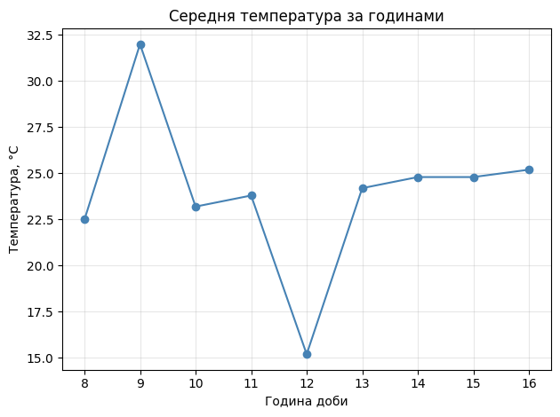

# Аналіз даних IoT-датчиків

## Опис проєкту

Навчальний аналіз синтетичного набору даних про датчики IoT-стенда (варіант 24) мовою Python (pandas, matplotlib). Проєкт створено в межах лабораторної роботи «Gemini Notebook, Google Colab і GitHub».

## Структура репозиторію

- `notebooks/` — notebook з аналізом (`lab_analysis.ipynb`)
- `data/` — навчальний набір даних `iot_sensors.csv`
- `docs/` — діаграми та документи

## Як запустити

1. Натисніть кнопку Open in Colab.
2. Виконайте Runtime -> Run all.

## Дані

Набір вигаданий (синтетичний), 36 записів: sensor, temperature, humidity, hour, location. Три значення навмисно аномальні, щоб було що шукати в аналізі.

## Результати

Середня температура за годинами на діаграмі спотворена двома аномаліями (58,0 °C і −12,0 °C); в інші години вона становить 22,5–25,2 °C.

## Автор

Щесняк А., група ПІ-25-01
